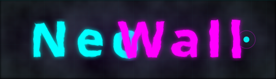

<p align="center">
  
</p>

<h1 align="center">neowall</h1>

<p align="center">
  GPU shader wallpapers for Linux. Wayland and X11.
</p>

<p align="center">
  <a href="https://github.com/1ay1/neowall/actions/workflows/build.yml"></a>
  <a href="https://github.com/1ay1/neowall/releases"></a>
  <a href="https://aur.archlinux.org/packages/neowall-bin"></a>
  <a href="LICENSE"></a>
</p>

<p align="center">
  <video src="https://github.com/user-attachments/assets/3a55d4e2-7257-4884-8aa2-9024ec86a560" width="49%" controls autoplay loop muted></video>
  <video src="https://github.com/user-attachments/assets/c1e38d88-5c1e-4db4-9948-da2ad86c6a69" width="49%" controls autoplay loop muted></video>
</p>

neowall runs GLSL fragment shaders as your desktop background. Shadertoy
shaders work unmodified, and every shader can react to your music, your
system, the time of day, your windows and your colour theme. It also shows
images, slideshows, and terminal programs as wallpaper.

- **Light on resources.** Stops rendering when windows cover the wallpaper
  (about 0.1% CPU), and you can cap the frame rate or render soft passes at a
  fraction of the resolution. The default wallpaper costs about 1.2 ms of GPU
  time per frame at 3440×1440.
- **Made for writing shaders.** Live reload with errors at the real file and
  line, offline rendering to PNG or video, per-pass GPU timing, and a check
  that finds the pass producing NaN pixels.
- **Solid.** A single C binary with no runtime dependencies beyond the
  graphics stack, tested under address, undefined-behaviour and thread
  sanitizers, fuzzed, and checked end to end on real Wayland and X11 sessions.

## Install

| Distribution | |
|--------------|-|
| Arch Linux | `paru -S neowall-bin` (prebuilt) or `neowall-git` |
| Debian, Ubuntu | `.deb` from the [latest release](https://github.com/1ay1/neowall/releases/latest) |
| Fedora, openSUSE | `.rpm` from the latest release |
| Nix | `nix run github:1ay1/neowall` |
| Anything else | the AppImage, or a tarball that runs in place |

Building from source needs a C11 compiler, Meson, Ninja, and the development
packages for EGL, OpenGL, libpng, libjpeg, Wayland and wayland-protocols, plus
X11 and Xrandr for the X11 backend and xkbcommon for keyboard input to
terminal wallpapers:

```bash
git clone https://github.com/1ay1/neowall && cd neowall
meson setup build && ninja -C build
sudo ninja -C build install
```

## Quick start

```bash
neowall           # start; the first run shows the default wallpaper
```

The configuration lives in `~/.config/neowall/config.vibe`:

```
default {
  shader tokyo_night
}
```

`neowall reload` applies changes. A slideshow, a terminal program, or a
different wallpaper per monitor are a few lines more; see
[CONFIGURATION.md](docs/CONFIGURATION.md).

| Command | |
|---------|-|
| `neowall next`, `set <n>`, `list` | Move through a slideshow or a directory of shaders |
| `neowall pause`, `resume` | Stop and restart cycling |
| `neowall pause-shader [--ease-ms MS]`, `resume-shader` | Freeze the animation, optionally easing the shader clock to a stop |
| `neowall current` | Show what each monitor displays |
| `neowall reload`, `kill` | Re-read the config, stop the daemon |

`neowall pause-shader --ease-ms 850` slows the shader's `iTime` clock over
850 milliseconds, then holds the last frame without drawing new ones.
`neowall resume-shader` continues from that clock position. Use
`neowall pause-shader` for an immediate freeze.

## Shaders

About twenty ship with neowall, all freely licensed:

| Vibe | A few |
|------|-------|
| Default | `tokyo_night` |
| Living | `garden` · `circadian_sky` · `living_aurora` |
| Nature | `moon_ocean` · `rain_window` · `fireflies` |
| Reactive | `audio_pulse` · `audio_bars` · `system_deck` |
| Desktop-aware | `window_light` · `window_forge` · `mouse_ripples` |
| Abstract | `plasma_touch` · `neon_city` · `time` |
| Space | `star_next` · `starfield_warp` |

To write your own:

```bash
neowall new aurora           # a working shader in ~/.config/neowall/shaders/
neowall watch aurora         # live reload as you edit
neowall render aurora        # render it offscreen to aurora.png
```

[SHADERS.md](docs/SHADERS.md) covers the inputs, the standard library, 3D
scenes, multiple passes and Shadertoy import.

## Compatibility

neowall draws the wallpaper with the `wlr-layer-shell` protocol on Wayland and
as the root window on X11.

- **Works on** Hyprland, Sway, river, Wayfire, KDE Plasma and other
  compositors with layer-shell, and on X11 window managers such as i3,
  bspwm, awesome, xmonad and qtile.
- **Window awareness** (shaders reacting to window positions) is available on
  Hyprland.
- **GNOME on Wayland is not supported:** Mutter doesn't implement layer-shell,
  and neowall says so and exits instead of showing nothing.
- **KDE Plasma:** desktop icons can be hidden while neowall owns the
  background layer.
- **Video** is out of scope; for video wallpapers use
  [mpvpaper](https://github.com/GhostNaN/mpvpaper).

## Documentation

| | |
|-|-|
| [Configuration](docs/CONFIGURATION.md) | Every option, with examples |
| [Writing shaders](docs/SHADERS.md) | Inputs, helpers, passes, the authoring tools |
| [Performance](docs/PERFORMANCE.md) | Measuring and reducing GPU cost |
| [Architecture](docs/ARCHITECTURE.md) | How the code is organised, for contributors |
| [Contributing](CONTRIBUTING.md) | Building, testing and sending changes |
| [Changelog](CHANGELOG.md) | What changed in each release |

`man neowall` and `man neowall.vibe` cover the same ground offline.

## License

MIT. The bundled shaders in `examples/shaders/` are MIT too; community ports
with other licenses live in [`contrib/`](contrib/shaders-unlicensed/) and are
not installed.
